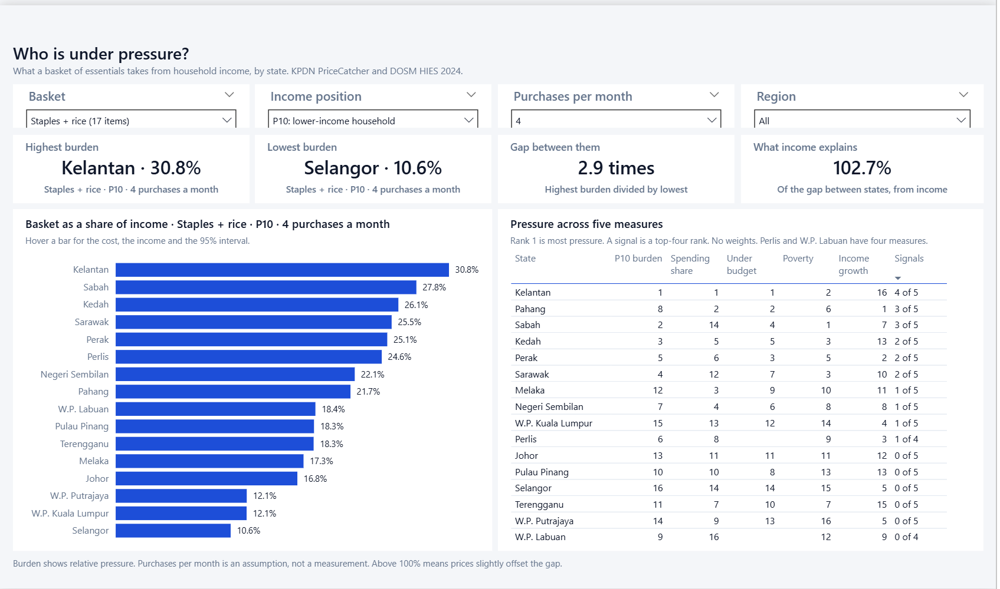

# Malaysia Affordability Atlas

**Which Malaysian households are under the most pressure, and what drives it?**



Asking where prices are high gives a small answer: the same basket of essentials costs within
about 11% across Malaysia. Asking who feels it gives a much bigger one. This project joins
KPDN PriceCatcher shelf prices to DOSM income, spending, poverty, CPI and wage data, then adds
the official poverty line and the Belanjawanku reference budgets, to measure pressure by state,
income position and household type.

Built with **SQL (DuckDB)**, **Python** and **Power BI** (star schema, 48 DAX measures, 4 pages).

## What the data said

| The question | What the data said | Where |
|---|---|---|
| Who is under the most pressure? | Four purchases a month of a 17-item basket take **30.8%** of income for a household at the 10th percentile in Kelantan, against **10.6%** in Selangor, a gap of 2.9 times. | [`mart_burden.csv`](data/processed/mart_burden.csv) |
| Is that a price gap? | No. Across the 12 combinations of basket and income position, income accounts for **101% to 106%** of the gap between states and prices for **-1% to -6%**. A share below zero means prices slightly offset the gap, because dearer states tend to be richer. | [`mart_decomposition.csv`](data/processed/mart_decomposition.csv) |
| What would change Kelantan's burden? | Give it a typical price and 30.8% falls to **29.8%**. Give it Malaysia's income at the same percentile and it falls to **21.5%**. | [`mart_counterfactual.csv`](data/processed/mart_counterfactual.csv) |
| Can a family meet a reference budget? | **73%** of all households in Kelantan earn less than the Belanjawanku budget for a couple with two children in Kota Bharu. In Selangor, against the Klang Valley budget, it is **20%**. | [`mart_budget_gap.csv`](data/processed/mart_budget_gap.csv) |
| Who shows up on several measures? | **Kelantan** in the top four on 4 of 5 measures, then **Sabah** and **Pahang** on 3 of 5. | [`mart_pressure.csv`](data/processed/mart_pressure.csv) |
| Is it getting better? | In the worst-placed state, yes: Kelantan's real median income rose **10.0%** from 2022 to 2024, the fastest in the country. **Pahang** was the only state where it fell, by 0.5%. Real formal wages rose in every state from 2022-23 to 2025-26, by 4.4% to 11.2%. | [`mart_real_income.csv`](data/processed/mart_real_income.csv), [`mart_real_wages.csv`](data/processed/mart_real_wages.csv) |
| Where does the money go? | Housing and utilities take **30.5%** of spending in W.P. Kuala Lumpur and 18.9% in Kelantan. Food at home takes 11.9% and 22.0%. | [`fact_spending_state.csv`](data/processed/fact_spending_state.csv) |

Pahang is the row I would take to a policy meeting. On basket burden alone it ranks eighth and
looks unremarkable. It appears only because the measures are kept side by side: second-highest
spending share, 67% of households under the family budget, and the one fall in real income. A
single headline index would have averaged that away, so this project does not build one.

## How the comparison is made

1. **Baskets are defined once**, in [`baskets.csv`](data/seed/baskets.csv). The earlier
   PriceCatcher basket had no rice, so two of the three baskets here add it.
2. **Dates are aligned.** Prices are Oct 2025 to Sep 2026 and incomes are 2024, so each state's
   basket is moved back to 2024 with its own food CPI. Income is not projected forward.
3. **Income is read at a position**, using each state's percentile cut-offs. P10 in Kelantan is
   RM2,014 and P10 in Selangor is RM5,643. Both are that state's own 10th percentile.
4. **Price and income are separated** by a variance decomposition, then by swapping each one
   for a benchmark, state by state.
5. **Published benchmarks replace assumptions where they exist.** The poverty line and
   Belanjawanku budgets are read from their source tables.

## What this can and cannot tell you

- **The purchase count is an assumption.** Household quantities are not observed, so burden shows
  relative pressure and is not a share of a real food bill. The report has a control for it. It
  cannot change a ranking, so robustness is tested between baskets instead, where the lowest
  rank correlation is 0.96.
- **The budget figure is about all households.** It is the share of all households earning under
  a budget, not the share of households of that type. A city budget is applied to a whole state.
- **The average PGK is not a cut-off.** PGK is set for each household, so it is compared with
  P10 for context only. Official poverty rates remain the measure of poverty.
- **Mean spending is never set against median income.** Some districts appear to spend more than
  they earn on that comparison, which is a statistical artefact and not overspending.
- **Rice is affected by composition**, because monitored brands differ between Peninsular Malaysia
  and Sabah and Sarawak.
- **Coverage has gaps.** W.P. Labuan and W.P. Putrajaya have thin shop samples and are flagged.
  District figures cover 12 states and 2024 only, with no prices. Household size and rent at
  lower incomes are not in the data.

The full method is in [`docs/METHODOLOGY.md`](docs/METHODOLOGY.md).

## The report

| Page | Question |
|---|---|
| [Who is under pressure?](assets/page-1-pressure.png) | Burden by state, with basket, income position, purchases and region controls |
| [What drives it?](assets/page-2-drivers.png) | Income against cost, the decomposition, price and income swaps, spending mix |
| [Can households meet a reference budget?](assets/page-3-budgets.png) | Nine Belanjawanku household types and the poverty line |
| [What has changed, and where?](assets/page-4-growth.png) | Real income, real wages and 162 districts |

## Run it

Needs Python 3.13 and Power BI Desktop. Prices come from the processed tables of
[`pricecatcher-retail-pricing`](https://github.com/Downey112/pricecatcher-retail-pricing), so clone
it beside this repo and run its pipeline first, or set `PRICECATCHER_DIR`.

```bat
python -m venv .venv
.venv\Scripts\pip install -r requirements.txt
run_pipeline.bat
```

The run downloads the DOSM data, builds the warehouse, bootstraps the intervals, runs the
validation gates and generates the report. Then open `powerbi\AffordabilityAtlas.pbip` and choose
**Refresh now**, because the generated project holds no data until its first refresh.

## Repository

```text
data/seed/       Baskets and Belanjawanku budgets
data/processed/  Star schema and marts, as CSV and Parquet
sql/             Staging, dimensions, facts, marts
scripts/         Ingest, build, bootstrap, validate, generate the report
powerbi/         Power BI Project (TMDL and PBIR)
docs/            Methodology
```

## Sources

KPDN PriceCatcher, via data.gov.my. DOSM OpenDOSM: HIES, CPI and formal wages, plus the 2024
poverty and household expenditure releases. Belanjawanku 2024/2025, EPF and the Social Wellbeing
Research Centre, Universiti Malaya.
